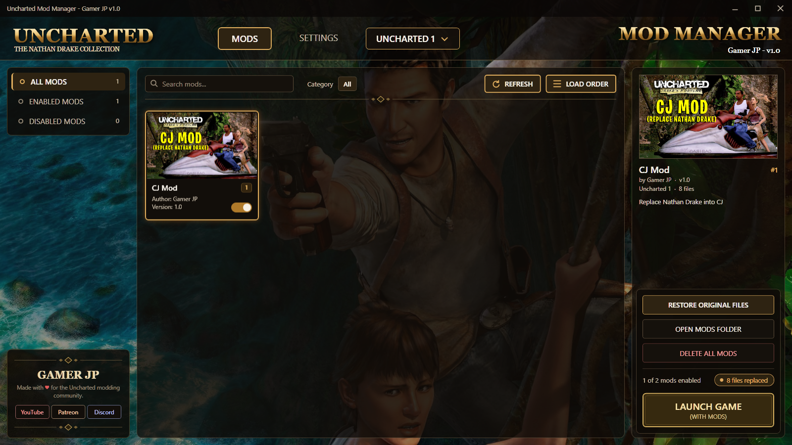
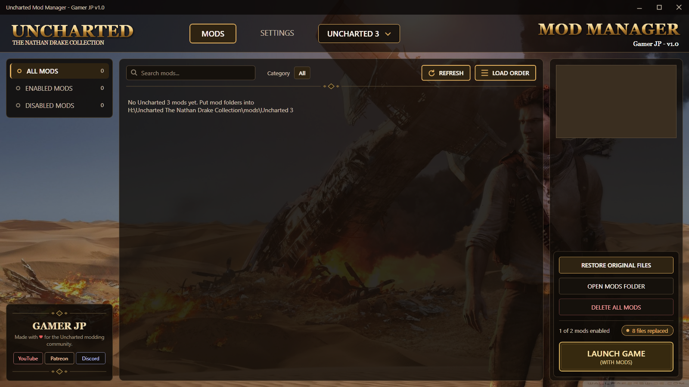
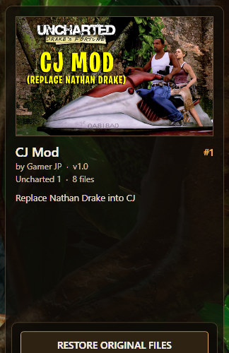

<p align="center">
  
</p>
<h1 align="center">Uncharted Mod Manager</h1>
<p align="center">
  <b>by Gamer JP · v1.0</b><br>
  Install, enable, disable and order mods for Uncharted 1, 2 and 3 in one click.<br>
  Every game file a mod replaces is backed up and put back when you switch the mod off.
</p>
<p align="center">
  <a href="https://www.youtube.com/@jpthehero">YouTube</a> ·
  <a href="https://www.patreon.com/c/gamerjp">Patreon</a> ·
  <a href="https://discord.gg/uBTutBA8VX">Discord</a>
</p>

---



## Contents

- [What it is](#what-it-is)
- [Features](#features)
- [Requirements](#requirements)
- [Install](#install)
- [Using the mod manager](#using-the-mod-manager)
- [Adding mods](#adding-mods)
- [mod.ini](#modini)
- [Load order and conflicts](#load-order-and-conflicts)
- [Settings](#settings)
- [How it works](#how-it-works)
- [Uninstall](#uninstall)
- [Troubleshooting](#troubleshooting)
- [FAQ](#faq)
- [Building from source](#building-from-source)
- [Credits and disclaimer](#credits-and-disclaimer)

---

## What it is

Uncharted: The Nathan Drake Collection has no mod loader: a mod is a game file (for example Drake's
`hero-default.pak`) that replaces the original one.

The **Uncharted Mod Manager** does that replacing for you, safely:

- **Switch a mod on**: the game's original file is backed up once, then the mod's file is copied into the game.
- **Switch it off**: the original file comes back, byte for byte.

Everything ships as **one exe**.

## Features

- **Single exe**: put it in the game folder and start it. No installer, no extra files.
- **Three games**: a dropdown switches between **Uncharted 1**, **Uncharted 2** and **Uncharted 3**, each with its own mods and background. The last game you picked opens next time.
- **Mod cards**: preview picture, name, author, version and an on / off switch.
- **Safe file swap**: originals are kept in `mods\_manager\backup` and restored exactly.
- **Never backs up a modded file**: Uncharted 1 game files are checked against the original checksums, and files installed by other tools are refused.
- **Load order**: when two mods replace the same file, the lower one wins. A warning shows the conflict.
- **RESTORE ORIGINAL FILES**: every mod off, every original back, in one click.
- **Game-folder check**: a mod only shows in the game whose folder it sits in, and only when its `mod.ini` names the same game.
- **Search and categories**: filter by name, author or character.
- **Mod updates**: change a mod's files while it is enabled, press **REFRESH**, and the new version is copied in.
- **Safe while playing**: nothing is changed while the game is running.
- **LAUNCH GAME**: applies your mods and starts the game.

## Requirements

| | |
|---|---|
| Game | Uncharted: The Nathan Drake Collection, the Windows port that runs the PS4 game files (folder with `Uncharted.exe` and `Game\`) |
| OS | Windows 10 or 11, 64-bit |
| Runtime | .NET Framework 4.x (already part of Windows) |

> Mods are made for the game files of one version. A mod made for another dump of the game may not load.

## Install

1. Download **Uncharted Mod Manager.exe** and put it in the game folder (the one with `Uncharted.exe`).
2. Start it. The `mods` folder and its `Uncharted 1`, `Uncharted 2` and `Uncharted 3` folders are made for you.
3. Pick the game in the dropdown, press **OPEN MODS FOLDER** and put your mod folders in there.
4. Press **REFRESH**, switch the mods you want on, then **LAUNCH GAME**.

> Some antivirus programs flag new, unsigned exe files. If yours does, add an exception for the manager.

## Using the mod manager


| Area | What it does |
|---|---|
| **MODS / SETTINGS** | Switch between the mod list and the folder settings. |
| **Game dropdown** | **UNCHARTED 1**, **UNCHARTED 2** or **UNCHARTED 3**: shows that game's mods with its own background. |
| **ALL / ENABLED / DISABLED MODS** | Filter the cards, with the count of each. |
| **Search mods** | Filter by name, author, character or folder. |
| **Category** | Filter by the `Character` of the mods. |
| **REFRESH** | Read the mods folder again and copy in any changed mod files. |
| **LOAD ORDER** | Order the enabled mods (see [Load order](#load-order-and-conflicts)). |
| **Mod card** | Preview, name, author, version. The number is its place in the load order. |
| **Switch on a card** | Enable or disable the mod: the game files are swapped right away. |
| **Details (right)** | Preview, name, author and version, game and file count, description. |
| **RESTORE ORIGINAL FILES** | Disable every mod and put every original game file back. |
| **OPEN MODS FOLDER** | Open the mods folder of the picked game. |
| **DELETE ALL MODS** | Restore the originals, then delete every mod folder (asks first). |
| **Status pill** | **Original files**, **N files replaced** or **Game running**. |
| **LAUNCH GAME** | Apply the mods and start `Uncharted.exe`. |



## Adding mods

Every mod is one folder inside the folder of its game:

```
<game folder>\
├── Uncharted.exe
├── Uncharted Mod Manager.exe
├── Game\
└── mods\
    ├── Uncharted 1\
    │   └── CJ Mod\
    │       ├── mod.ini          name, game, author, description, version
    │       ├── preview.png      card picture (16:9 looks best)
    │       └── Game\u1data\build\main\actor20\ps4\
    │           ├── hero-default.pak
    │           └── hero-dirty-beatup.pak  ...
    ├── Uncharted 2\
    └── Uncharted 3\
```

The files inside a mod can be:

```
the game's own layout   Game\u2data\build\main\actor27\ps4\hero-default.pak  -> exactly that game file
just the file           hero-default.pak                                     -> found in that game's files by its name
```

A new mod starts **disabled**.

> **Wrong folder:** a mod whose `mod.ini` says `Game : Uncharted 1` but sits in `mods\Uncharted 3` is not shown.
> Mods placed directly in `mods\` (not in a game folder) are not shown either.

## mod.ini

Every mod should have a `mod.ini` that looks exactly like this. Without it, the card only shows the folder name and the details stay empty, so always add one:

```
Name : CJ Mod
Game : Uncharted 1
Author : Gamer JP
Description : Replace Nathan into CJ
Version : 1.0
```

| Field | Shown in the manager |
|---|---|
| Name | Card title and details |
| Game | `Uncharted 1`, `Uncharted 2` or `Uncharted 3`: must match the folder the mod is in |
| Author | Card and details |
| Description | Details |
| Version | Card and details |
| Character | Optional: the category filter |

One field per line, written as `Field : value`. The `Game` line is required: it must match the folder the mod is in.



## Load order and conflicts

- Enabled mods have a number: their place in the load order.
- When two enabled mods replace the same file, the **higher number wins**. A warning under the cards names both mods and the file.
- **LOAD ORDER** opens the list: drag a row, or use **MOVE UP** / **MOVE DOWN**, then **SAVE ORDER**. The game files are updated right away.
- The order and on / off state are saved in `mods\manager.ini`.

## Settings

| Setting | |
|---|---|
| Game folder | The folder with `Uncharted.exe` and `Game\`. Found by itself when the manager sits in it. |
| Mods folder | Any location. Default: `<game folder>\mods`. |

The settings are saved in `%APPDATA%\Uncharted Mod Manager\settings.ini`. Change the mods folder only while no mod is
applied (press **RESTORE ORIGINAL FILES** first).

## How it works

```
switch ON   game file ──copy──> mods\_manager\backup\<same path>     (only the first time)
            mod file  ──copy──> game file

switch OFF  mods\_manager\backup\<path> ──copy──> game file          (byte-exact original)
            a file the mod added is deleted
```

- `mods\_manager\state.txt` lists every game file a mod replaced. Do not delete `_manager` while mods are enabled.
- Every copied file gets a new date, so the port rebuilds anything it prepared from the old file.
- A game file is never backed up when it is not the original: an Uncharted 1 file with the wrong checksum, or a file
  installed by another tool, is refused with a message.

## Uninstall

- **Play without mods:** press **RESTORE ORIGINAL FILES**.
- **Remove everything:** press **RESTORE ORIGINAL FILES**, then delete `Uncharted Mod Manager.exe` and the `mods` folder.

## Troubleshooting

| Problem | Fix |
|---|---|
| "Close the game first" | The game is running: its files are in use. Close it and switch the mod again. |
| My mod is not in the list | Check that it is in `mods\Uncharted N`, and that the `Game` line of its `mod.ini` names the same game. Press **REFRESH**. |
| "...was installed by another tool" | That game file was replaced by another tool. Restore it with that tool first, then enable the mod here. |
| "...is not the original file" | The game file was changed outside the manager. Put the original back (or verify / reinstall the game), then enable the mod. |
| "...is not a game file" | A file in the mod has a name the game does not use. Use the game's own folder layout (`Game\...`). |
| The mod shows but nothing changes in game | Make sure it is switched on (it has a number) and that no later mod replaces the same file. |
| The game crashes or loads forever with a mod | Switch it off: the original comes back. The mod may be too big or made for another game version. |
| Antivirus removed the exe | A false alarm for new unsigned programs. Restore it and add an exception. |

## FAQ

**Does it change my game files?**
Yes, that is how Uncharted mods work. Every original is backed up first and restored when you switch the mod off.

**Can I keep my mods on another drive?**
Yes: set the mods folder in **SETTINGS**.

**Can I use mods for all three games?**
Yes. Each game has its own folder under `mods`, and the dropdown switches between them.

**Can two mods for the same character be on together?**
Only if they replace different files. When they replace the same file, the later one in the load order wins.

**What happens if I delete a mod folder while it is enabled?**
The next time the manager runs, its files are restored from the backup.

**Is it safe online?**
The manager does not touch saves or online features. Use mods in single player.

## Building from source

| Part | Source | Build |
|---|---|---|
| Mod manager | `ModManager.cs`, `Installer.cs`, `Originals.cs` | `build.bat` |
| Backgrounds and icon | `bg_u1.jpg`, `bg_u2.jpg`, `bg_u3.jpg`, `app_icon.png`, `app.ico` | embedded by `build.bat` |

`build.bat` uses the C# compiler that comes with Windows (no Visual Studio needed). For testing,
`"Uncharted Mod Manager.exe" --sync <game folder> <mods folder>` applies `mods\manager.ini` without the window and
writes a report to `mods\_manager\last_sync.txt`.

## Credits and disclaimer

- Made by **Gamer JP** with ♥ for the Uncharted modding community.
- Uncharted is a trademark of Sony Interactive Entertainment. Uncharted was made by Naughty Dog. This is an unofficial fan tool, not made or endorsed by them.
- Mods are made by their authors. Keep a backup of your saves.
